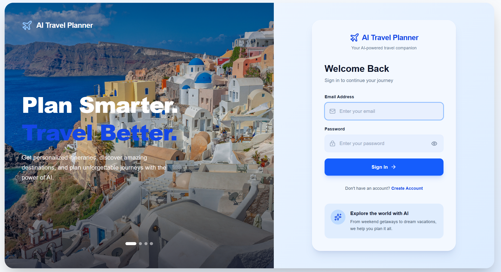
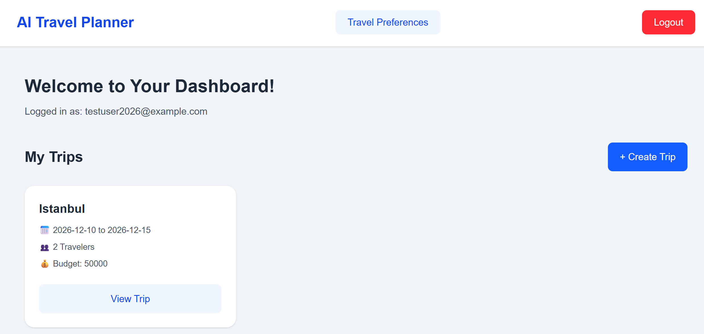
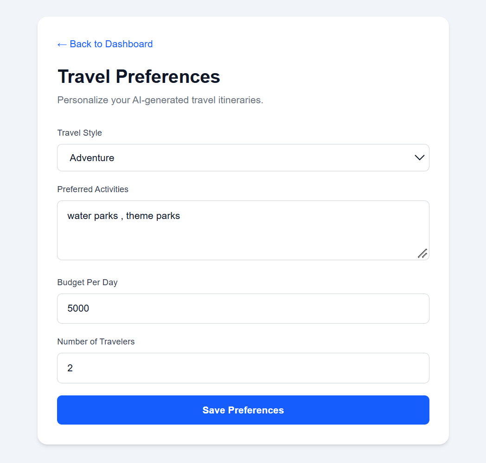
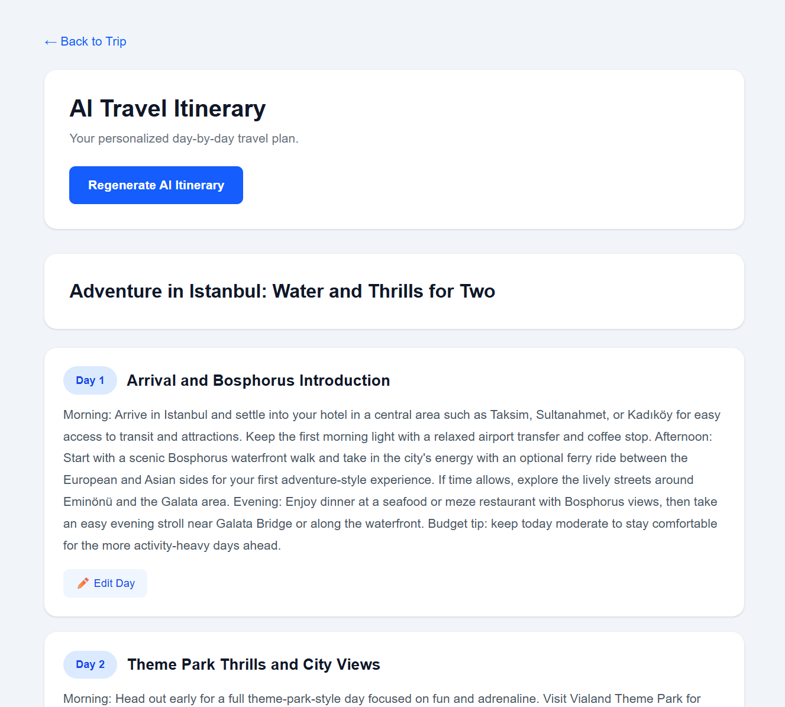

# ✈️ AI Travel Planner — Frontend

### Plan Smarter. Travel Better.

**Next.js | React | TypeScript | Tailwind CSS | AI-Powered Travel Planning**

**Project Status: MVP (Minimum Viable Product)**

🌐 **Live Application:** https://ai-travel-planner-frontend-theta.vercel.app

⚙️ **Backend Repository:** https://github.com/SkAfreen/ai-travel-planner-backend

---

## 🌍 About the Project

AI Travel Planner is a full-stack web application that helps users create personalized travel itineraries using artificial intelligence.

Instead of spending hours researching destinations, activities, and schedules, users can generate structured, day-by-day travel plans based on their preferences.

The application considers travel details such as destination, trip duration, budget, number of travelers, preferred activities, and travel style.

The frontend provides an interactive interface for managing trips, configuring travel preferences, generating itineraries, and viewing previously saved travel plans.

## 🚧 Project Status — MVP

> **Important:** AI Travel Planner is currently a functional Minimum Viable Product (MVP). It demonstrates the application's core capabilities and does not represent the final product.

The current version includes working authentication, travel preference management, trip management, AI itinerary generation, and persistent itinerary storage.

Future versions may include additional functionality, improved user experience, expanded travel integrations, and performance enhancements.

This repository is part of a full-stack AI development portfolio.

---

## ✨ Key Features

### 🔐 User Authentication

* User registration and login.
* Email verification.
* JWT-based authentication through the Spring Boot backend.
* Protected application pages.
* Logout functionality.

### 🧳 Trip Management

* Create trips with destination, dates, budget, and traveler information.
* View saved trips on the dashboard.
* Access trip details and generated itineraries.

### 🎯 Personalized Travel Preferences

Configure:

* Travel style.
* Preferred activities.
* Daily budget.
* Number of travelers.

Saved preferences are used to personalize AI-generated itineraries.

### 🤖 AI-Powered Itinerary Generation

Generate detailed travel itineraries based on trip information and travel preferences.

The application supports:

* Day-by-day travel plans.
* Personalized activity recommendations.
* Budget-aware planning.
* Viewing previously generated itineraries.
* Editing individual itinerary days.
* Regenerating itineraries.

The MVP has been successfully tested with a 30-day personalized itinerary.

### 📊 Dashboard

The dashboard allows authenticated users to view their saved trips and navigate to trip details, travel preferences, and itineraries.

---

## 📸 Application Screenshots

### 1. Login Page



### 2. Dashboard



### 3. Travel Preferences



### 4. AI-Generated Itinerary



The screenshots demonstrate the current MVP interface. The final product may have a different design and additional functionality.

---

## 🛠️ Technology Stack

| Component            | Technology     |
| -------------------- | -------------- |
| Frontend Framework   | Next.js 16     |
| UI Library           | React 19       |
| Programming Language | TypeScript     |
| Styling              | Tailwind CSS   |
| Icons                | Lucide React   |
| Backend Integration  | REST APIs      |
| Authentication       | JWT            |
| Frontend Deployment  | Vercel         |
| Version Control      | Git and GitHub |

---

## 🏗️ Application Architecture

```text
                 USER
                  |
                  v
          NEXT.JS FRONTEND
             (Vercel)
                  |
                  | HTTPS / REST APIs
                  v
         SPRING BOOT BACKEND
              (Render)
                  |
           +------+------+
           |             |
           v             v
       PostgreSQL     AI Service
         (Neon)
```

The frontend communicates with the Spring Boot backend through REST APIs.

The backend handles authentication, business logic, database persistence, and AI itinerary generation.

---

## 📂 Frontend Structure

```text
travelplanner-frontend/
│
├── public/
│   └── screenshots/
│       ├── login.png
│       ├── dashboard.png
│       ├── preferences.png
│       └── itinerary.png
│
├── src/
│   └── app/
│       ├── login/
│       ├── register/
│       ├── verify-email/
│       ├── dashboard/
│       ├── travel-preferences/
│       └── trips/
│           ├── new/
│           └── [tripId]/
│               └── itinerary/
│
├── package.json
├── next.config.ts
└── README.md
```

---

## ⚙️ Local Development

### Prerequisites

* Node.js and npm.
* Access to a running AI Travel Planner backend.

### 1. Clone the repository

```bash
git clone https://github.com/SkAfreen/ai-travel-planner-frontend.git
cd ai-travel-planner-frontend
```

### 2. Install dependencies

```bash
npm install
```

### 3. Configure the backend URL

Create a `.env.local` file in the project root:

```env
NEXT_PUBLIC_API_URL=http://localhost:8080
```

This variable specifies the backend API URL.

**Note:** Variables prefixed with `NEXT_PUBLIC_` are accessible in the browser. Never place API secrets or private credentials in them.

### 4. Start the development server

```bash
npm run dev
```

Open the local application at `http://localhost:3000`.

### 5. Create a production build

```bash
npm run build
```

---

## ☁️ Deployment

The frontend MVP is deployed on Vercel.

**Live Demo:** https://ai-travel-planner-frontend-theta.vercel.app

The backend is deployed on Render, with PostgreSQL hosted on Neon.

The production frontend uses the `NEXT_PUBLIC_API_URL` environment variable to communicate with the backend.

---

## 🧪 Testing

The following workflows have been manually tested in the deployed MVP:

| Test                               | Result |
| ---------------------------------- | ------ |
| User registration                  | Passed |
| Duplicate email handling           | Passed |
| Email verification                 | Passed |
| User login                         | Passed |
| Dashboard                          | Passed |
| Travel preference updates          | Passed |
| Trip creation                      | Passed |
| AI itinerary generation            | Passed |
| Personalized itinerary generation  | Passed |
| 30-day itinerary generation        | Passed |
| Saved trip and itinerary retrieval | Passed |
| Logout and protected-page redirect | Passed |

These are manual functional test results and do not constitute a comprehensive security or performance audit.

---

## 🗺️ Future Development

Potential improvements include:

* Enhanced mobile experience.
* Interactive maps.
* Additional destination discovery features.
* Travel booking integrations.
* More advanced itinerary customization.
* Improved budget visualization.
* Expanded automated testing.
* Performance and accessibility improvements.

These features are proposed enhancements and are not claimed as implemented.

---

## 👩‍💻 Development

This application was developed as a full-stack AI project, including:

* Frontend development with Next.js, React, and TypeScript.
* Integration with Spring Boot REST APIs.
* Authentication and protected application workflows.
* AI itinerary generation integration.
* Travel preference and trip management interfaces.
* Cloud deployment and production testing.

AI-assisted coding tools were used during development.

---

## 📌 Disclaimer

**AI Travel Planner is a functional MVP developed for demonstration, learning, and portfolio purposes.**

It does not represent the final commercial product. The application is subject to further development, testing, and refinement.

---

**AI Travel Planner — MVP Version 1.0**

*Plan Smarter. Travel Better.*
